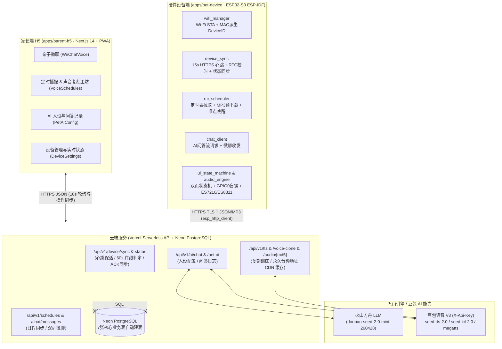

# 「小铭同学」（AI Chat Pet）—— 智能语音宠物全栈系统

**「小铭同学」** 是基于 **微雪（Waveshare）`ESP32-S3-Touch-AMOLED-2.16`**（2.16 寸 480×480 方形 AMOLED 屏、`CO5300` + `CST9220` 触控、`ES7210` 双麦阵列硬件 AEC、`ES8311` 解码功放、`PCF85063` 硬件 RTC）打造的儿童智能陪伴与亲子双向微聊全栈系统。

详细原始产品需求与交互原型草案见 [docs/esp32-ai-pet-solution.md](docs/esp32-ai-pet-solution.md)。

---

## 一、三大核心功能

1. **AI 宠物伴聊（豆包大模型 + 豆包语音 V3）**
   - 家长可自定义宠物昵称、性格人设模板（System Prompt）与萌宠音色，调节外放音量。
   - 孩子在设备端按住屏幕提问，云端调用火山方舟大模型生成口语化回答，并实时调用豆包语音 V3 合成音频返回播放；问答文本自动同步至家长端记录。
2. **定时语音播报 & 爸妈声音复刻**
   - 支持家长输入文字转宠物萌音、或上传/录制 5~15 秒原声调用**豆包声音复刻（`seed-icl-2.0`）**生成专属 `S_xxx` 音色进行定时提醒。
   - 云端按 `(voiceType + text)` 生成确定性 MD5 并提供永久音频地址 `/api/v1/audio/[md5]`，ESP32 后台静默预下载缓存，结合本地 `PCF85063` 硬件 RTC 在断网状态下也可准点唤醒播放；孩子点击屏幕确认后回传 `alarm_ack`。
3. **亲子双向微聊**
   - 家长在 H5 按住录音或输入文字发送给设备，支持“直接外放”或“未读红点提示点击收听”；孩子在设备端副页或按住侧面实体按键（`GPIO0`）即可快速发送语音给家长，播放后双向同步已读状态（`voice_read`）。

---

## 二、最终系统技术架构



---

## 三、关键技术方案设计

### 1. 设备与云端通信协议设计

* **现网落地协议：HTTPS REST + 15 秒周期心跳保活**
  * **选型原因**：后端部署于 **Vercel Serverless** 无状态函数环境（原生不支持持久化 WebSocket/MQTT Broker 长连接），因此采用 ESP32 `esp_http_client` + TLS 证书校验（`esp_crt_bundle`）直连 Vercel REST API，**零额外中间件成本**。
  * **单次心跳多路复用**（`POST /api/v1/device/sync`）：
    1. **上行上报**：`deviceId`（由出厂 MAC 派生如 `esp32_pet_a1b2`）、`macAddress`、`firmwareVersion`、`batteryPercent`、`wifiRssi` 及确认事件（`alarm_ack`、`voice_read`）。
    2. **在线判定**：服务端记录 `last_seen_at`，家长端查询 `/api/v1/device/status` 时以 **最近 60 秒内收到过心跳** 为「在线」，否则为「离线」。
    3. **下行配置**：返回 `serverEpochSec`（自动校准 ESP32 系统与 RTC 时间）、`volumeLevel`（实时音量同步）、`unreadMessagesCount`（触发拉取微聊）与 `enabledSchedulesCount`（变更时触发拉取日程表）。
* **进阶实时推送演进（可选）**：
  * 若后续需要家长发送微聊后 **< 0.5 秒** 硬件立即响应，可在云端接入独立 MQTT Broker（如 EMQX Cloud），ESP32 使用 `esp-mqtt` 订阅 `pet/{deviceId}/cmd` 接收指令唤醒，音频文件仍走 HTTPS 下载。
  * 实时全双工语音流对话可使用 WebSocket（Opus/PCM 帧）。

### 2. 分层音频持久化策略

为了兼顾 ESP32 离线闹钟可靠性与 Vercel + Neon 数据库存储成本，系统采用严格区分的存储策略：

| 业务类型 | 音频存储策略 | 数据库落库内容 |
| :--- | :--- | :--- |
| **功能二：定时语音播报** | **持久化缓存**：按 `(voiceType + text)` 生成确定性 MD5 存入 `tts_audio_files` 表，通过 `GET /api/v1/audio/[md5]` 暴露永久地址（带 `Cache-Control: public, max-age=31536000, immutable` 供 Vercel Edge CDN 缓存及 ESP32 预下载） | 日程元数据 + `audio_url` + `audio_md5` |
| **功能一：AI 宠物伴聊** | **不保存音频**（`persist: false`）：LLM 回复后实时合成 MP3 返回播放，播完释放 | 仅在 `ai_chat_logs` 保存纯文本问答记录 |
| **功能三：亲子双向微聊** | **不持久化聊天音频文件**：按轻量流式/即时转写传递 | 仅在 `chat_voice_messages` 保存消息元数据、状态（`unread`/`played`）及 `asr_text` |

### 3. Neon PostgreSQL 数据表结构

应用首次访问时由 [neonDb.ts](file:///Users/liuzhe.x/coding/ai-chat-pet/apps/parent-h5/src/server/neonDb.ts) 自动幂等建表，无需手工迁移：

* `devices`：设备注册绑定、MAC、固件版本、电量、`wifi_rssi`、音量与最后心跳时间 `last_seen_at`。
* `pet_ai_configs`：按 `device_id` 存储宠物昵称、人设模板 ID、TTS 音色 ID、System Prompt 与音量。
* `ai_chat_logs`：孩子与 AI 宠物的文本问答记录。
* `voice_clone_profiles`：爸妈复刻音色档案（支持自定义或自动生成 `S_xxx` Speaker ID）。
* `voice_schedules`：定时语音任务（时间、重复周期 JSONB、音源类型、关联音色、音频 URL/MD5、孩子确认状态 `last_ack_status`）。
* `tts_audio_files`：定时播报 MP3 二进制 Base64 与 MD5 去重缓存表。
* `chat_voice_messages`：亲子微聊双向消息记录与未读状态。

---

## 四、Monorepo 目录与模块说明

```text
ai-chat-pet/
├── docs/
│   └── esp32-ai-pet-solution.md        # 原始产品需求与硬件交互设计方案
├── packages/
│   └── contracts/                      # 跨端共享 TypeScript 数据模型与人设常量
├── apps/
│   ├── parent-h5/                      # 家长端 H5 + Vercel Serverless 后端 (Next.js 14)
│   │   ├── src/server/
│   │   │   ├── neonDb.ts               # Neon PostgreSQL 连接与自动建表
│   │   │   ├── deviceStore.ts          # 设备心跳、绑定与在线状态计算
│   │   │   ├── appDataStore.ts         # 日程、微聊、人设、日志、复刻音色 CRUD
│   │   │   ├── audioStore.ts           # 定时播报 MP3 持久化与按 MD5 去重
│   │   │   └── doubaoVoice.ts          # 豆包语音 V3 TTS 2.0 & 声音复刻上传/状态查询
│   │   ├── src/app/api/v1/
│   │   │   ├── device/sync/route.ts    # 设备心跳 & alarm_ack / voice_read 上报
│   │   │   ├── device/status/route.ts  # 家长端实时查询/绑定/解绑设备
│   │   │   ├── ai/chat/route.ts        # 方舟大模型问答 + 豆包 TTS 实时回复
│   │   │   ├── pet-ai/route.ts         # AI 人设读写与问答日志拉取
│   │   │   ├── schedules/route.ts      # 定时语音任务增删改查与开关
│   │   │   ├── chat/messages/route.ts  # 亲子微聊双向消息收发与已读标记
│   │   │   ├── voice-clone/route.ts    # 豆包声音复刻上传、状态查询与档案管理
│   │   │   ├── tts/route.ts            # 豆包 TTS 语音合成接口
│   │   │   └── audio/[md5]/route.ts    # 永久音频 HTTP 下载/播放端点
│   │   └── src/views/                  # WeChatVoice / VoiceSchedules / PetAIConfig / DeviceSettings
│   └── pet-device/                     # 微雪 ESP32-S3-Touch-AMOLED-2.16 固件 (ESP-IDF)
│       ├── main/
│       │   ├── main.c                  # 系统入口：初始化 Wi-Fi、音频、RTC、UI 与云端同步任务
│       │   ├── Kconfig.projbuild       # menuconfig 配置 Wi-Fi、Server URL 与心跳间隔
│       │   ├── wifi_manager.c/.h       # Wi-Fi STA 连网重连与 MAC 派生 DeviceID
│       │   ├── device_sync.c/.h        # 15s HTTPS 心跳、时间校准、音量与 ACK 上报
│       │   ├── rtc_scheduler.c/.h      # 拉取云端日程 JSON、MP3 预缓存、本地 RTC 闹钟监控
│       │   ├── chat_client.c/.h        # AI 对话音频流请求与亲子微聊双向收发
│       │   ├── ui_state_machine.c/.h   # 双页+全局闹钟状态机、GPIO0 物理按键防抖与盲操控制
│       │   └── audio_engine.c/.h       # ES7210 双麦 AEC 录音与 ES8311 音量/播放控制
│       └── preview/index.html          # 480×480 方形 AMOLED 屏幕交互预览器
└── supabase/schema.sql                 # PostgreSQL 参考建表脚本
```

---

## 五、本地开发与部署指南

### 1. 环境变量配置（`apps/parent-h5/.env.local`）

可通过 `vercel env pull` 从关联的 Vercel 项目拉取，核心变量如下：

```ini
# Neon PostgreSQL（Vercel 集成自动注入）
DATABASE_URL=postgresql://...

# 火山引擎「豆包语音」V3（仅需一个 API Key）
DOUBAO_SPEECH_API_KEY=你的豆包语音API_KEY
VOLC_V3_CLONE_RESOURCE_ID=seed-icl-2.0
VOLC_V3_TTS_RESOURCE_ID=seed-tts-2.0
VOLC_PET_VOICE_TYPE=zh_female_vv_uranus_bigtts

# 火山方舟大模型（用于小铭同学问答）
ARK_API_KEY=你的火山方舟API_KEY
ARK_MODEL_ID=doubao-seed-2-0-mini-260428
```

### 2. 启动家长端 H5 与生产构建

```bash
# 安装依赖
pnpm install

# 启动本地开发服务 (http://localhost:5189)
pnpm dev:h5

# TypeScript 类型检查与 Next.js 生产构建验证
pnpm --filter parent-h5 exec tsc --noEmit
pnpm build:h5
```

### 3. Vercel 部署说明

* Vercel 控制台设置 **Root Directory** 为 `apps/parent-h5`，关联 Neon PostgreSQL 存储并配置上述 `DOUBAO_SPEECH_API_KEY` 与 `ARK_API_KEY` 即可一键发布。

### 4. ESP32-S3 固件编译与烧录（ESP-IDF）

```bash
cd apps/pet-device
idf.py set-target esp32s3
# 在 "AI Chat Pet (小铭同学) Configuration" 中配置 Wi-Fi SSID/密码与后端 URL
idf.py menuconfig
idf.py build flash monitor
```

* 设备首次开机串口将打印派生出的设备 ID（如 `Device ID: esp32_pet_a1b2`）并开始向 `/api/v1/device/sync` 发送心跳。
* 在家长端 H5 的 **「设备」->「配对新设备」** 中输入该 `Device ID` 完成绑定，即可实时查看在线状态、电量并同步日程与微聊语音。
