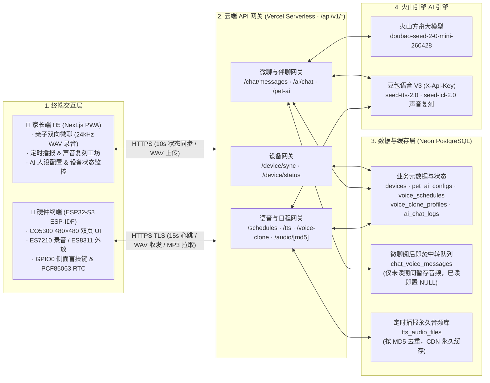
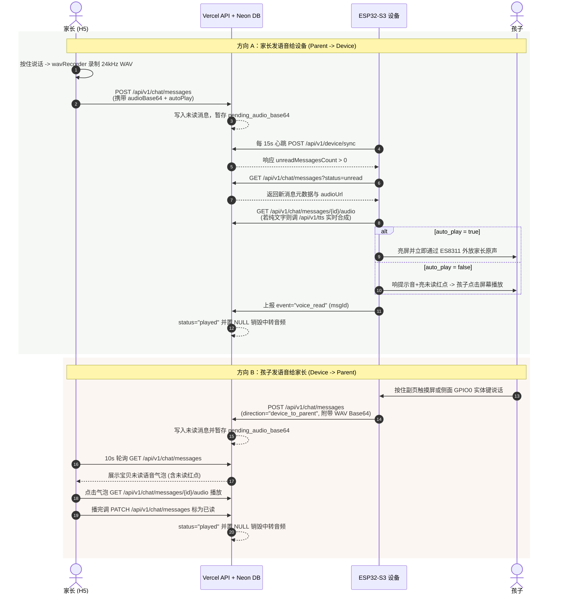

# 「小铭同学」（AI Chat Pet）—— 智能语音宠物全栈技术方案

**「小铭同学」** 是基于 **微雪（Waveshare）`ESP32-S3-Touch-AMOLED-2.16`**（2.16 寸 480×480 方形 AMOLED 屏、`CO5300` + `CST9220` 触控、`ES7210` 双麦硬件 AEC、`ES8311` 扬声器、`PCF85063` 硬件 RTC）打造的儿童智能陪伴与亲子双向微聊全栈系统。

原始产品需求文档见 [docs/esp32-ai-pet-solution.md](docs/esp32-ai-pet-solution.md)。

---

## 一、系统总体技术架构

系统采用 **「双端（家长 H5 + ESP32-S3 硬件） ↔ Vercel Serverless API ↔ Neon PostgreSQL + 火山引擎 AI」** 的四层清晰架构：



### 通信协议选型说明

* **当前落地协议（HTTPS REST + 15 秒心跳多路复用）**：
  * 后端部署在 **Vercel Serverless** 无状态函数环境（原生不支持持久化 WebSocket/MQTT 服务端长连接），因此 ESP32 端使用 `esp_http_client` + `esp_crt_bundle` 直连 HTTPS API，**零额外网关维护成本**。
  * ESP32 每 15 秒上报一次 `POST /api/v1/device/sync`（心跳保活、`alarm_ack`、`voice_read`、电量、Wi-Fi RSSI），并在同一响应中下行获取：`serverEpochSec`（RTC 校时）、`volumeLevel`、`unreadMessagesCount`、`enabledSchedulesCount`，实现**在线判定（60 秒 TTL）**与**消息/日程同步**。
* **后续进阶演进（可选）**：
  * 如需家长发微聊后 **< 0.5 秒** 硬件立即响铃唤醒，可独立接入 MQTT Broker（如 EMQX Cloud），ESP32 通过 `esp-mqtt` 订阅指令主题唤醒拉取音频。
  * 如需连续全双工实时打断对话，设备端可直连 WebSocket 流式语音通道。

---

## 二、核心业务与双向语音技术方案

### 2.1 家长与设备双向发送语音技术方案（亲子微聊）

系统支持 **「按住录制真声（WAV）」** 与 **「输入文字实时转语音（TTS）」** 两种发送方式，兼顾**原声保真传输**与**数据库零冗余存储（阅后即焚）**：

1. **端侧音频编码格式统一为 24kHz 单声道 WAV**：
   * 家长端 H5 使用 Web Audio API（[wavRecorder.ts](file:///Users/liuzhe.x/coding/ai-chat-pet/apps/parent-h5/src/utils/wavRecorder.ts)）直接录制标准 PCM WAV，彻底规避了 iOS Safari 不兼容 `audio/webm`、以及 ESP32 端缺乏 WebM/Opus 复杂解复用器的问题。
   * ESP32 设备端通过 `ES7210` 采集 PCM 封装 WAV 头后（[chat_client.c](file:///Users/liuzhe.x/coding/ai-chat-pet/apps/pet-device/main/chat_client.c)），Base64 编码上传。
2. **「临时中转 + 阅后即焚」音频传输机制**：
   * 录音消息上传至 `POST /api/v1/chat/messages` 时，音频暂存于 Neon `chat_voice_messages.pending_audio_base64`，并生成临时拉取地址 `/api/v1/chat/messages/{id}/audio`。
   * 对方拉取播放并上报已读确认（设备端发 `voice_read` 心跳 / 家长端调 `PATCH /api/v1/chat/messages`）后，服务端**立即执行 `pending_audio_base64 = NULL` 销毁音频数据**，数据库仅保留文字与消息状态，实现「**不长期保存亲子聊天音频文件**」。
   * 若家长发送的是纯文字消息（未录音），则完全不经过临时音频队列，ESP32 收到后直接调用 `/api/v1/tts`（`persist: false`）实时合成语音播放。



---

### 2.2 AI 宠物伴聊实时语音方案

* **文本存库、音频流即播即弃（`persist: false`）**：
  1. 孩子按住 ESP32 主页触摸屏说话，提问经 `/api/v1/ai/chat` 送入火山方舟大模型（`doubao-seed-2-0-mini-260428`），结合设备绑定的 `pet_ai_configs` 人设 Prompt 生成 50 字内口语化回复。
  2. 纯文本问答对自动写入 `ai_chat_logs` 供家长查看；同时服务端立即调用豆包语音 V3（`seed-tts-2.0`）合成为 MP3 流（当 `responseFormat="mp3"` 时直接返回二进制流给 ESP32 播放），音频不写入数据库。

---

### 2.3 定时语音播报与爸妈声音复刻方案

1. **声音复刻（`seed-icl-2.0`）**：
   * 家长在 H5 录制 5~15 秒 WAV 样本，支持自定义或自动生成唯一 `S_mom_xxx` / `S_dad_xxx` 作为 `speaker_id` 调用 `/api/v1/mega_tts/audio/upload`，成功后将 `provider_voice_id` 存入 `voice_clone_profiles`。
2. **定时音频永久地址 + 硬件 RTC 离线响铃**：
   * 新建/编辑定时提醒时开启 `persist: true`，服务端将豆包合成的 MP3 按 `(voiceType + text)` 计算 MD5 存入 Neon `tts_audio_files`，生成永久地址 `/api/v1/audio/{md5}`（Edge CDN 缓存 1 年）。
   * ESP32 在心跳检测到日程变化后，调用 `GET /api/v1/schedules` 拉取 JSON 并静默预下载 MP3；由本地时间监控与 `PCF85063` 硬件 RTC 在指定 `HH:MM` 与星期掩码下准点触发响铃，孩子点击屏幕停止后上送 `alarm_ack` 更新任务确认时间。

---

## 三、分层音频存储与数据库表设计

| 数据表 | 存储类型 | 用途与生命周期 |
| :--- | :--- | :--- |
| `devices` | 结构化元数据 | 设备绑定信息、MAC、固件版本、电量、`wifi_rssi`、`last_seen_at`（60s 在线判定） |
| `pet_ai_configs` | 结构化元数据 | 按设备存储宠物昵称、人设模板、TTS 音色 ID、Prompt 与音量 |
| `ai_chat_logs` | 纯文本日志 | 记录孩子提问与宠物回答文本（**不存音频**） |
| `voice_clone_profiles` | 结构化元数据 | 爸妈复刻音色档案及对应的 `S_xxx` Speaker ID |
| `voice_schedules` | 结构化元数据 | 定时规则、文案、`audio_url`、MD5 及孩子点击确认状态 `last_ack_status` |
| `tts_audio_files` | **永久音频库** | **仅存放定时播报 MP3**（Base64 + MD5 去重），支撑 `/api/v1/audio/[md5]` |
| `chat_voice_messages` | **元数据 + 阅后即焚队列** | 消息元数据持久保留；`pending_audio_base64` 仅在 `unread` 期间暂存，已读后立刻清空 |

> 所有表由 [neonDb.ts](file:///Users/liuzhe.x/coding/ai-chat-pet/apps/parent-h5/src/server/neonDb.ts) 在服务端首次请求时自动幂等创建。

---

## 四、Monorepo 代码目录说明

```text
ai-chat-pet/
├── docs/
│   └── esp32-ai-pet-solution.md        # 原始产品需求与硬件交互规范
├── packages/
│   └── contracts/                      # 跨端共享 TypeScript 数据模型与人设常量
├── apps/
│   ├── parent-h5/                      # 家长端 H5 + Vercel Serverless 后端 (Next.js 14)
│   │   ├── src/server/
│   │   │   ├── neonDb.ts               # Neon PostgreSQL 连接与 7 张表自动初始化
│   │   │   ├── deviceStore.ts          # 设备心跳、绑定、音量同步与 60s 在线判定
│   │   │   ├── appDataStore.ts         # 日程、微聊(含阅后即焚音频)、人设、日志 CRUD
│   │   │   ├── audioStore.ts           # 定时播报 MP3 持久化与按 MD5 去重
│   │   │   └── doubaoVoice.ts          # 豆包语音 V3 TTS 2.0 & 声音复刻接口封装
│   │   ├── src/app/api/v1/
│   │   │   ├── device/sync/route.ts    # 设备心跳、校时、音量与 alarm_ack / voice_read
│   │   │   ├── device/status/route.ts  # 家长端设备实时在线状态查询与绑定/解绑
│   │   │   ├── ai/chat/route.ts        # 火山方舟 LLM 问答 + 豆包 TTS 实时语音回复
│   │   │   ├── pet-ai/route.ts         # AI 宠物人设读写与问答记录查询
│   │   │   ├── schedules/route.ts      # 定时语音任务增删改查与开关
│   │   │   ├── chat/messages/route.ts  # 亲子双向微聊消息收发与已读状态同步
│   │   │   ├── chat/messages/[id]/audio/route.ts # 未读微聊原声 WAV 临时投递端点
│   │   │   ├── voice-clone/route.ts    # 豆包声音复刻上传、状态查询与档案管理
│   │   │   ├── tts/route.ts            # 豆包 TTS 语音合成接口
│   │   │   └── audio/[md5]/route.ts    # 定时播报永久 MP3 下载/播放端点
│   │   └── src/views/                  # WeChatVoice / VoiceSchedules / PetAIConfig / DeviceSettings
│   └── pet-device/                     # 微雪 ESP32-S3-Touch-AMOLED-2.16 固件 (ESP-IDF)
│       ├── main/
│       │   ├── main.c                  # 入口：初始化 Wi-Fi、音频、RTC、UI 与心跳同步任务
│       │   ├── Kconfig.projbuild       # menuconfig 配置 Wi-Fi、Server URL 与心跳周期
│       │   ├── wifi_manager.c/.h       # Wi-Fi STA 连网重连与 MAC 派生 DeviceID
│       │   ├── device_sync.c/.h        # 15s HTTPS 心跳、RTC 校时、音量与 ACK 上报
│       │   ├── rtc_scheduler.c/.h      # 拉取定时任务 JSON、MP3 预缓存与准点唤醒
│       │   ├── chat_client.c/.h        # AI 对话音频流请求与亲子微聊 WAV 双向收发
│       │   ├── ui_state_machine.c/.h   # 双页状态机、GPIO0 物理按键防抖与闹钟确认
│       │   └── audio_engine.c/.h       # ES7210 双麦 AEC 录音与 ES8311 音量/播放控制
│       └── preview/index.html          # 480×480 方形 AMOLED 屏幕交互预览器
└── supabase/schema.sql                 # PostgreSQL 参考建表脚本
```

---

## 五、本地开发与部署指南

### 1. 环境变量配置（`apps/parent-h5/.env.local`）

```ini
# Neon PostgreSQL（Vercel 集成自动注入，可用 vercel env pull 拉取）
DATABASE_URL=postgresql://...

# 火山引擎「豆包语音」V3（仅需一个 API Key）
DOUBAO_SPEECH_API_KEY=你的豆包语音API_KEY
VOLC_V3_CLONE_RESOURCE_ID=seed-icl-2.0
VOLC_V3_TTS_RESOURCE_ID=seed-tts-2.0
VOLC_PET_VOICE_TYPE=zh_female_vv_uranus_bigtts

# 火山方舟大模型（用于小铭同学问答）
ARK_API_KEY=你的火山方舟API_KEY
ARK_MODEL_ID=doubao-seed-2-0-mini-260428
```

### 2. 本地启动与验证

```bash
pnpm install
pnpm dev:h5

# 类型检查与生产构建验证
pnpm --filter parent-h5 exec tsc --noEmit
pnpm build:h5
```

### 3. ESP32-S3 固件编译与设备绑定

```bash
cd apps/pet-device
idf.py set-target esp32s3
idf.py menuconfig   # 在 "AI Chat Pet (小铭同学) Configuration" 填入 Wi-Fi 与 Vercel 域名
idf.py build flash monitor
```

1. 固件启动后串口会打印出厂 MAC 派生的唯一设备 ID（如 `Device ID: esp32_pet_a1b2`），并开始每 15 秒向云端发送心跳。
2. 打开家长端 H5 **「设备」->「配对新设备」** 绑定该 ID，即可实时同步在线状态、电量并开展双向微聊与定时播报。
