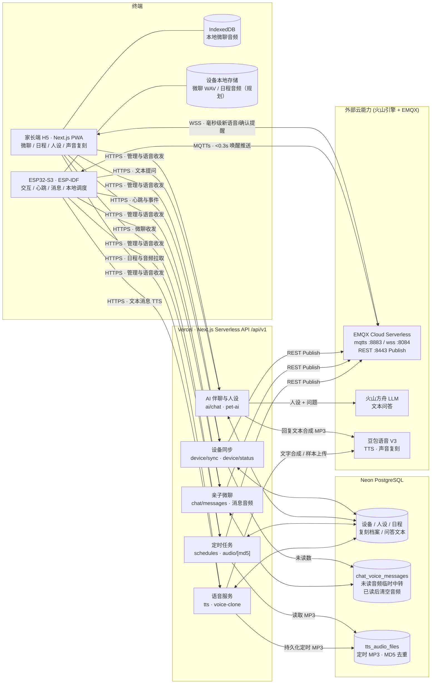
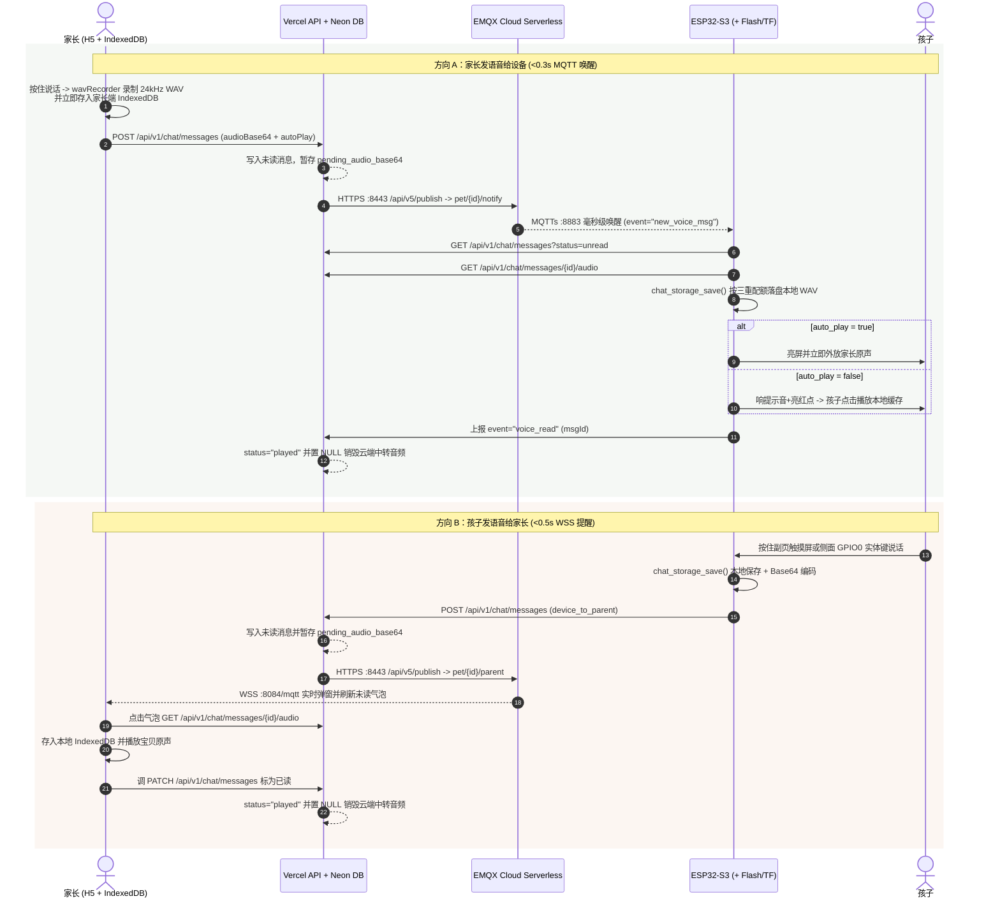

# 「小铭同学」（AI Chat Pet）—— 智能语音宠物全栈技术方案

> 当前运行路径使用 HTTPS 轮询同步；下文涉及 EMQX/MQTT 实时通知的描述为旧方案，代码中已停用。设备音频驱动尚未实现播放完成确认，因此设备暂不会将语音标记为已读或删除云端音频。目前提供单家庭共享密码与设备令牌；没有多家庭身份隔离，也没有内置分布式登录限流，不适合直接面向公众开放。

**「小铭同学」** 是基于 **微雪（Waveshare）`ESP32-S3-Touch-AMOLED-2.16`**（2.16 寸 480×480 方形 AMOLED 屏、`CO5300` + `CST9220` 触控、`ES7210` 双麦硬件 AEC、`ES8311` 扬声器、`PCF85063` 硬件 RTC）打造的儿童智能陪伴与亲子双向微聊全栈系统。

原始产品需求文档见 [docs/esp32-ai-pet-solution.md](docs/esp32-ai-pet-solution.md)。

---

## 一、系统总体技术架构

系统由 **家长 H5、ESP32-S3 固件、Vercel Serverless API、Neon PostgreSQL 和火山引擎 AI 服务**组成。下图按业务入口展开，箭头表示主要请求及数据去向；设备端尚未完成的部分见图后的说明。



三条主要业务链路：

1. **亲子微聊**：H5 与设备通过消息 API 收发语音；Neon 暂存未读音频，接收端保存并确认后清除云端音频。
2. **AI 伴聊**：设备向 `ai/chat` 发送文本问题，服务端读取人设、调用方舟生成回复，再调用豆包语音合成；问答文本存库，回复音频不持久化。
3. **定时播报**：H5 调用 `tts` 生成并持久化音频，再保存日程；设备通过心跳检查日程数量、拉取任务及音频，计划在本地定时播放并上报确认。

> **实现状态**：上图展示当前方案及已有 API 链路，并非设备端功能均已跑通。固件的录音、播放和界面硬件驱动目前主要为占位实现；AI 接口接收文本，语音识别尚未接入。日程音频下载尚未落盘，PCF85063 硬件 RTC 及离线唤醒尚未接入；当前使用系统时间轮询，且仅在启用日程数量变化时重新拉取。设备文件系统挂载及重启后的缓存索引恢复也有待实现。下文设备交互、离线播报及音频存储的描述为目标方案，需以代码实现状态为准。

### 通信协议选型说明

* **混合通信协议（EMQX Serverless MQTT 实时唤醒 + Vercel HTTPS 数据传输）**：
  * **控制面（实时唤醒 `< 0.3s`）**：接入 **EMQX Cloud Serverless** 免费托管集群：
    * **Vercel 后端**：不维护 TCP 长连，而是通过 EMQX REST API（`POST https://<host>:8443/api/v5/publish`，HTTP Basic Auth）毫秒级下发轻量信令。
    * **ESP32 设备端**（[mqtt_client_mgr.c](file:///Users/liuzhe.x/coding/ai-chat-pet/apps/pet-device/main/mqtt_client_mgr.c)）：通过原生 `esp-mqtt` 常连 `mqtts://<host>:8883` 订阅 `pet/{deviceId}/notify`，收到 `new_voice_msg` / `schedules_updated` / `config_updated` 后立刻拉取处理。
    * **家长端 H5**（[useMqttParentSync.ts](file:///Users/liuzhe.x/coding/ai-chat-pet/apps/parent-h5/src/utils/useMqttParentSync.ts)）：通过 `wss://<host>:8084/mqtt` 订阅 `pet/{deviceId}/parent`，实时接收孩子新语音及闹钟确认事件。
  * **数据面与兜底心跳（HTTPS REST）**：
    * WAV/MP3 音频流、定时日程 JSON、心跳保活与状态确认继续走 Vercel HTTPS REST API（`POST /api/v1/device/sync`，开启 MQTT 后心跳可设为 30~60s 省电保活；未配置 EMQX 时自动降级为轮询同步，零单点故障）。

---

## 二、核心业务与双向语音技术方案

### 2.1 家长与设备双向发送语音技术方案（亲子微聊）

系统支持 **「按住录制真声（WAV）」** 与 **「输入文字实时转语音（TTS）」** 两种发送方式，兼顾**原声保真传输**与**数据库零冗余存储（阅后即焚）**：

1. **端侧音频编码格式统一为 24kHz 单声道 WAV**：
   * 家长端 H5 使用 Web Audio API（[wavRecorder.ts](file:///Users/liuzhe.x/coding/ai-chat-pet/apps/parent-h5/src/utils/wavRecorder.ts)）直接录制标准 PCM WAV，彻底规避了 iOS Safari 不兼容 `audio/webm`、以及 ESP32 端缺乏 WebM/Opus 复杂解复用器的问题。
   * ESP32 设备端通过 `ES7210` 采集 PCM 封装 WAV 头后（[chat_client.c](file:///Users/liuzhe.x/coding/ai-chat-pet/apps/pet-device/main/chat_client.c)），Base64 编码上传。
2. **「云端阅后即焚中转 + 端侧本地持久存储」机制**：
   * 录音消息上传至 `POST /api/v1/chat/messages` 时，音频仅在 `unread` 期间暂存于 Neon `chat_voice_messages.pending_audio_base64`，并生成临时拉取地址 `/api/v1/chat/messages/{id}/audio`。
   * 一旦接收方拉取音频并落盘到**各自端侧本地存储**，随即上报已读确认（ESP32 发 `voice_read` / 家长端调 `PATCH /api/v1/chat/messages`），服务端**立即将 `pending_audio_base64` 置 `NULL` 销毁**，云端不长期囤积聊天录音。
   * 若家长发送的是纯文字消息（未录音），则完全不经过临时音频队列，ESP32 收到后直接调用 `/api/v1/tts`（`persist: false`）实时合成语音播放。
3. **端侧本地存储选型与容量淘汰方案**：

| 端侧 | 存储介质与技术选型 | 容量与淘汰策略（明确选型） | 选型依据 |
| :--- | :--- | :--- | :--- |
| **家长端 H5** | **浏览器 `IndexedDB`**<br>([chatAudioDb.ts](file:///Users/liuzhe.x/coding/ai-chat-pet/apps/parent-h5/src/utils/chatAudioDb.ts)) | • 上限：**最多 200 条** 且 **总大小 ≤ 100 MB**<br>• 按时间戳升序 LRU 淘汰最旧一条，支持界面一键清理 | `localStorage` 仅 5MB 上限会迅速溢出；`IndexedDB` 原生支持大容量 `Blob` 异步读写，云端清理后家长仍可在历史气泡中随时重听自己与孩子的原声。 |
| **ESP32-S3 设备** | **TF 卡 (`/sdcard/wechat`) 或板载 Flash (`/littlefs/wechat`)**<br>([chat_storage.c](file:///Users/liuzhe.x/coding/ai-chat-pet/apps/pet-device/main/chat_storage.c)) | **「体积上限 + 条数上限 + 过期天数」三重约束 FIFO**：<br>• **无 TF 卡（Flash 分区）**：`4 MB` · `20 条` · `7 天`<br>• **有 TF 卡（推荐）**：`128 MB` · `200 条` · `30 天`<br>• **目录隔离**：与定时提醒 `/alarms/` 分区隔离，互不挤占 | 单纯“按天”会在高频说话时写满 Flash；单纯“按条数”无法防单条超长录音爆盘。**体积 + 条数 + 天数三重约束（写入前先清过期，再循环踢出最旧 WAV）** 最稳妥，参数均可在 `idf.py menuconfig` 直接调节。 |



---

### 2.2 AI 宠物伴聊实时语音方案

* **文本存库、音频流即播即弃（`persist: false`）**：
  1. 孩子按住 ESP32 主页触摸屏说话，提问经 `/api/v1/ai/chat` 送入火山方舟大模型（`doubao-seed-2-0-mini-260428`），结合设备绑定的 `pet_ai_configs` 人设 Prompt 生成 50 字内口语化回复。
  2. 纯文本问答对自动写入 `ai_chat_logs` 供家长查看；同时服务端立即调用豆包语音 V3（`seed-tts-2.0`）合成为 MP3 流（当 `responseFormat="mp3"` 时直接返回二进制流给 ESP32 播放），音频不写入数据库。

---

### 2.3 定时语音播报与爸妈声音复刻方案

1. **声音复刻（`seed-icl-2.0`）**：
   * 家长在 H5 录制 5~15 秒 WAV 样本，支持自定义或自动生成唯一 `S_mom_xxx` / `S_dad_xxx` 作为 `speaker_id` 调用 `/api/v1/mega_tts/audio/upload`，成功后将 `provider_voice_id` 存入 `voice_clone_profiles`。
2. **定时音频永久地址 + 硬件 RTC 离线响铃**：
   * 新建/编辑定时提醒时开启 `persist: true`，服务端将豆包合成的 MP3 按 `(voiceType + text)` 计算 MD5 存入 Neon `tts_audio_files`，生成永久地址 `/api/v1/audio/{md5}`（Edge CDN 缓存 1 年）。
   * ESP32 在心跳检测到日程变化后，调用 `GET /api/v1/schedules` 拉取 JSON 并静默预下载 MP3；由本地时间监控与 `PCF85063` 硬件 RTC 在指定 `HH:MM` 与星期掩码下准点触发响铃，孩子点击屏幕停止后上送 `alarm_ack` 更新任务确认时间。

---

## 三、分层音频存储与数据库表设计

| 数据表 | 存储类型 | 用途与生命周期 |
| :--- | :--- | :--- |
| `devices` | 结构化元数据 | 设备绑定信息、MAC、固件版本、电量、`wifi_rssi`、`last_seen_at`（60s 在线判定） |
| `pet_ai_configs` | 结构化元数据 | 按设备存储宠物昵称、人设模板、TTS 音色 ID、Prompt 与音量 |
| `ai_chat_logs` | 纯文本日志 | 记录孩子提问与宠物回答文本（**不存音频**） |
| `voice_clone_profiles` | 结构化元数据 | 爸妈复刻音色档案及对应的 `S_xxx` Speaker ID |
| `voice_schedules` | 结构化元数据 | 定时规则、文案、`audio_url`、MD5 及孩子点击确认状态 `last_ack_status` |
| `tts_audio_files` | **永久音频库** | **仅存放定时播报 MP3**（Base64 + MD5 去重），支撑 `/api/v1/audio/[md5]` |
| `chat_voice_messages` | **元数据 + 阅后即焚队列** | 消息元数据持久保留；`pending_audio_base64` 仅在 `unread` 期间暂存，已读后立刻清空 |

> 所有表由 [neonDb.ts](file:///Users/liuzhe.x/coding/ai-chat-pet/apps/parent-h5/src/server/neonDb.ts) 在服务端首次请求时自动幂等创建。

---

## 四、Monorepo 代码目录说明

```text
ai-chat-pet/
├── docs/
│   └── esp32-ai-pet-solution.md        # 原始产品需求与硬件交互规范
├── packages/
│   └── contracts/                      # 跨端共享 TypeScript 数据模型与人设常量
├── apps/
│   ├── parent-h5/                      # 家长端 H5 + Vercel Serverless 后端 (Next.js 14)
│   │   ├── src/server/
│   │   │   ├── neonDb.ts               # Neon PostgreSQL 连接与 7 张表自动初始化
│   │   │   ├── deviceStore.ts          # 设备心跳、绑定、音量同步与 60s 在线判定
│   │   │   ├── appDataStore.ts         # 日程、微聊(含阅后即焚音频)、人设、日志 CRUD
│   │   │   ├── audioStore.ts           # 定时播报 MP3 持久化与按 MD5 去重
│   │   │   ├── emqxPublisher.ts        # EMQX Cloud Serverless HTTP API 推送封装
│   │   │   └── doubaoVoice.ts          # 豆包语音 V3 TTS 2.0 & 声音复刻接口封装
│   │   ├── src/app/api/v1/
│   │   │   ├── mqtt/config/route.ts    # 获取家长端 H5 WSS 订阅配置
│   │   │   ├── device/sync/route.ts    # 设备心跳、校时、音量与 alarm_ack / voice_read
│   │   │   ├── device/status/route.ts  # 家长端设备实时在线状态查询与绑定/解绑
│   │   │   ├── ai/chat/route.ts        # 火山方舟 LLM 问答 + 豆包 TTS 实时语音回复
│   │   │   ├── pet-ai/route.ts         # AI 宠物人设读写与问答记录查询
│   │   │   ├── schedules/route.ts      # 定时语音任务增删改查与开关
│   │   │   ├── chat/messages/route.ts  # 亲子双向微聊消息收发与已读状态同步
│   │   │   ├── chat/messages/[id]/audio/route.ts # 未读微聊原声 WAV 临时投递端点
│   │   │   ├── voice-clone/route.ts    # 豆包声音复刻上传、状态查询与档案管理
│   │   │   ├── tts/route.ts            # 豆包 TTS 语音合成接口
│   │   │   └── audio/[md5]/route.ts    # 定时播报永久 MP3 下载/播放端点
│   │   ├── src/utils/
│   │   │   ├── wavRecorder.ts          # 浏览器 24kHz Mono WAV 录音封装
│   │   │   ├── chatAudioDb.ts          # 家长端 IndexedDB 本地微聊语音库 (200条/100MB LRU)
│   │   │   └── useMqttParentSync.ts    # 家长端 EMQX WSS 毫秒级事件监听 Hook
│   │   └── src/views/                  # WeChatVoice / VoiceSchedules / PetAIConfig / DeviceSettings
│   └── pet-device/                     # 微雪 ESP32-S3-Touch-AMOLED-2.16 固件 (ESP-IDF)
│       ├── main/
│       │   ├── main.c                  # 入口：初始化 Wi-Fi、存储配额、音频、RTC、UI 与心跳/MQTT
│       │   ├── Kconfig.projbuild       # menuconfig 配置 Wi-Fi、Server URL、EMQX 与缓存配额
│       │   ├── wifi_manager.c/.h       # Wi-Fi STA 连网重连与 MAC 派生 DeviceID
│       │   ├── mqtt_client_mgr.c/.h    # EMQX Serverless TLS (8883) 毫秒级订阅唤醒
│       │   ├── device_sync.c/.h        # HTTPS 心跳兜底、RTC 校时、音量与 ACK 上报
│       │   ├── rtc_scheduler.c/.h      # 拉取定时任务 JSON、MP3 预缓存与准点唤醒
│       │   ├── chat_client.c/.h        # AI 对话音频流请求与亲子微聊 WAV 双向收发
│       │   ├── chat_storage.c/.h       # 设备端 Flash/TF 本地微聊存储 (体积+条数+天数三重 FIFO)
│       │   ├── ui_state_machine.c/.h   # 双页状态机、GPIO0 物理按键防抖与闹钟确认
│       │   └── audio_engine.c/.h       # ES7210 双麦 AEC 录音与 ES8311 音量/播放控制
│       └── preview/index.html          # 480×480 方形 AMOLED 屏幕交互预览器
└── supabase/schema.sql                 # PostgreSQL 参考建表脚本
```

---

## 五、本地开发与部署指南

### 单家庭 HTTPS 访问保护

家长使用共享用户名和家庭密码登录，服务端通过 HttpOnly、SameSite cookie 保存 7 天会话；设备使用独立令牌访问所需 API。**以下四项必须在运行环境和 Vercel 环境变量中配置，否则所有业务 API 返回 503**：

- `PET_FAMILY_USERNAME`：家庭共享登录用户名。
- `PET_FAMILY_PASSWORD`：家庭访问密码，至少 10 个字符，建议使用随机生成的高强度密码。
- `PET_SESSION_SECRET`：会话签名密钥，至少 32 个字符；更换它会使所有现有会话失效。
- `PET_DEVICE_TOKEN`：设备 API 令牌，至少 32 个字符；必须与设备端配置一致，且应与上面两项不同。

可使用 `openssl rand -hex 32` 分别生成独立密钥，配置到 `apps/parent-h5/.env.local` 与生产环境；不要提交密钥。设备通过 `idf.py menuconfig` 设置 `PET_DEVICE_TOKEN`，并确保 `PET_SERVER_URL` 为不带末尾斜杠的 HTTPS 地址。固件和 sdkconfig 包含设备令牌，需要按凭证保管。重新部署后需要重新配置并烧录设备；旧固件无法通过认证。

这是单家庭原型方案，所有持有设备令牌的设备共享该家庭的设备权限。暴露公网前应在网关配置登录限流，并评估设备凭证轮换、家庭隔离与审计；仅有密码登录并不提供这些能力。浏览器退出会清除当前浏览器的会话，要立即撤销其他会话需轮换 `PET_SESSION_SECRET`。

### 1. 环境变量配置（`apps/parent-h5/.env.local`）

```ini
# Neon PostgreSQL（Vercel 集成自动注入，可用 vercel env pull 拉取）
DATABASE_URL=postgresql://...

# 火山引擎「豆包语音」V3（仅需一个 API Key）
DOUBAO_SPEECH_API_KEY=你的豆包语音API_KEY
VOLC_V3_CLONE_RESOURCE_ID=seed-icl-2.0
VOLC_V3_TTS_RESOURCE_ID=seed-tts-2.0
VOLC_PET_VOICE_TYPE=zh_female_vv_uranus_bigtts

# 火山方舟大模型（用于小铭同学问答）
ARK_API_KEY=你的火山方舟API_KEY
ARK_MODEL_ID=doubao-seed-2-0-mini-260428

# EMQX Cloud Serverless（可选，用于 <0.3s 毫秒级推送）
EMQX_HOST=你的部署域名.emqxsl.com
EMQX_HTTP_PORT=8443
EMQX_APP_ID=你的EMQX_App_ID
EMQX_APP_SECRET=你的EMQX_App_Secret
EMQX_WSS_PORT=8084
EMQX_CLIENT_USERNAME=你在EMQX创建的客户端用户名
EMQX_CLIENT_PASSWORD=你在EMQX创建的客户端密码
```

### 2. 本地启动与验证

```bash
pnpm install
pnpm dev:h5

# 类型检查与生产构建验证
pnpm --filter parent-h5 exec tsc --noEmit
pnpm build:h5
```

### 3. ESP32-S3 固件编译与设备绑定

```bash
cd apps/pet-device
idf.py set-target esp32s3
idf.py menuconfig   # 在 "AI Chat Pet (小铭同学) Configuration" 填入 Wi-Fi 与 Vercel 域名
idf.py build flash monitor
```

1. 固件启动后串口会打印出厂 MAC 派生的唯一设备 ID（如 `Device ID: esp32_pet_a1b2`），并开始每 15 秒向云端发送心跳。
2. 打开家长端 H5 **「设备」->「配对新设备」** 绑定该 ID，即可实时同步在线状态、电量并开展双向微聊与定时播报。
