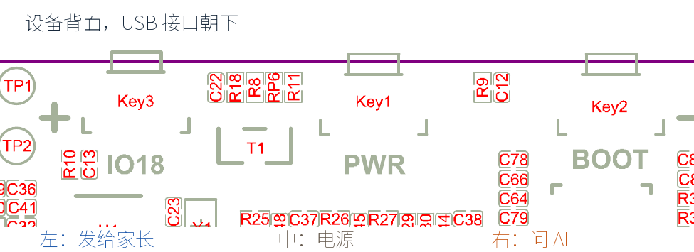

# 小铭同学 · AI Chat Pet

基于微雪 **ESP32-S3-Touch-AMOLED-2.16** 的语音宠物：家长端微聊、按住问 AI、定时语音提醒。仓库包含 Next.js 家长 H5/API、ESP-IDF 固件和共享类型。

本文按 **2026-11-19 的实际实现与联调结果**整理；产品原始规划见 [产品方案](docs/esp32-ai-pet-solution.md)。规划中的 MQTT、TF 卡历史语音库、关机唤醒等能力，不代表当前固件已经启用。

## 1. 当前状态与使用方式

| 功能 | 当前实现 | 验证情况 / 边界 |
| --- | --- | --- |
| 屏幕与触摸 | 480×480 三级页面（首页胶囊导航、爸妈微聊历史列表、AI 聊天灵动面罩页）；按住说话、松开发送 | 实机确认可自由切换页面；实体键（IO18/IO0）与触摸长按手势均可触发录音与发送 |
| 设备绑定 | 8 位绑定码；家长批准后领取设备独立 Token，存入 NVS | 已验证绑定、重启保留、解绑撤销及权限隔离 |
| 发给家长 | 16 kHz 录音 → AAC → HTTPS 上传；列表实时渲染待发态、重试按钮与本地试听 | 录音回放、失败重试及历史上传已验证；重录实时替换本地待发缓冲 |
| 失败重发 | 保留最近一条录音；“重新发送”沿用原音频和消息 ID | SPIFFS 写入/恢复自检通过；服务端并发去重及已读后重试通过真实 PostgreSQL 验证 |
| 家长语音接收 | 家长端 16 kHz/32 kbps MP3 压缩 + ESP32 32KB TCP 窗口 + PSRAM 零阻塞直放 + 心跳预下载 | 6 秒语音体积由 ~300-500 KB 降至 ~24 KB，下载由 20s+ 缩短至 <1s，预热命中 <0.1s 秒播；支持即时取消/打断 |
| AI 语音聊天 | 独立 Visor 面罩页 + 发光青色 Bot 眼睛（眨眼/倾听/思考/说话动效）；Ogg Opus → ASR → LLM → MP3 回复 → PSRAM 直播 | 云端完整链路、设备编码与 MP3 播放分别通过；视觉与交互已对齐实机体验 |
| 定时播报 | 日程与音频落盘、RTC 校时、开机状态下离线触发、点击确认 | 实机离线触发和播放自检通过；星期、单次任务、跨年和重启去重规则测试通过 |
| 消息同步 | HTTPS 心跳轮询 + 静默未读预加载 | 心跳检测未读消息并在后台预热音频；当前未启动 MQTT |

看**设备背面，USB 接口朝下**，三个按键从左到右：

| 位置 | 丝印 / GPIO | 功能 |
| --- | --- | --- |
| 左 | IO18 / GPIO18 | 按住给家长录音，松开发送 |
| 中 | PWR | 保留电源功能 |
| 右 | BOOT / GPIO0 | 按住问 AI，松开发送问题 |



屏幕两个页面也有对应的按住按钮。录音范围为 **300 毫秒～15 秒**；轻点按键可能只录到 0.1～0.2 秒，出现“录音太短”属于正常保护。新录音会替换上一条待发录音；失败后可以直接重发，无需再说一遍。

定时任务需先同步并下载音频，之后保持设备开机即可断网播放。点“知道了”停止提醒并确认；离线确认保存后等待联网补报。**未实现关机或深睡眠状态下的 RTC 唤醒。**

## 2. 代码入口

| 位置 | 作用 |
| --- | --- |
| `apps/parent-h5` | Next.js 14 家长界面、API、鉴权、数据库及火山服务调用 |
| `packages/contracts` | 跨端 TypeScript 类型与人设常量 |
| `apps/pet-device/main/main.c` | 固件初始化入口 |
| `main/ui_state_machine.c`、`hardware_keys.c` | 触摸、页面、重发入口、实体键防抖和按下/松开事件 |
| `main/pet_display.c` | 沿用微雪屏幕及触摸方向，限制显示传输块，避免 DMA 内存不足 |
| `main/audio_engine.c`、`voice_encoder.c` | 录音、编码、持久待发队列、实际解码播放与代数中断 |
| `main/audio_download.c` | 8 KB 分片带超时检测、支持代数即时打断、直接读入 PSRAM 的流式拉取器 |
| `main/chat_client.c`、`pet_http_route.c` | 语音 HTTP 请求、未读静默预热（Prefetch）、阶段日志及 DNS 切换 |
| `main/device_pairing.c`、`device_sync.c` | 绑定凭据、心跳、未读触发预拉取、音量、校时及确认事件 |
| `main/device_storage.c`、`rtc_scheduler.c` | SPIFFS、日程缓存、PCF85063、离线调度及确认队列 |
| `main/pet_font.c` | 编译进固件的中文字体子集 |
| `apps/parent-h5/src/utils/wavRecorder.ts` | 前端录音器：支持 16 kHz / 32 kbps MP3 实时压缩与 WAV 容灾降级 |
| `apps/parent-h5/src/server/speechRecognition.ts` | 豆包极速 ASR 与音频格式校验 |
| `src/server/doubaoVoice.ts`、`appDataStore.ts` | TTS / 声音复刻，日程、微聊、人设和文本日志 |

表内 `main/...` 相对 `apps/pet-device`；`src/...` 相对 `apps/parent-h5`。`mqtt_client_mgr.c` 和 `chat_storage.c` 保留旧方案代码，但当前主流程未启用 MQTT 或旧历史缓存索引。

## 3. 家长端开发与部署

### 环境变量

本地配置放在 **`apps/parent-h5/.env.local`**，不是仓库根目录；生产配置在 Vercel 项目的环境变量中维护。不要把真实 API Key、家庭密码、设备 Token 或 Wi-Fi 密码写进 README、日志或 Git。

```ini
DATABASE_URL=postgresql://...

PET_FAMILY_USERNAME=你的家庭用户名
PET_FAMILY_PASSWORD=至少10个字符的家庭密码
PET_SESSION_SECRET=至少32个字符的随机服务端密钥

# 语音识别 / 合成：使用服务端语音 Key，并确认对应资源已开通
DOUBAO_SPEECH_API_KEY=你的豆包语音Key
VOLC_ASR_RESOURCE_ID=volc.bigasr.auc_turbo
VOLC_V3_TTS_RESOURCE_ID=seed-tts-2.0
VOLC_V3_CLONE_RESOURCE_ID=seed-icl-2.0
VOLC_PET_VOICE_TYPE=zh_female_vv_uranus_bigtts

# LLM
ARK_API_KEY=你的火山方舟Key
ARK_MODEL_ID=doubao-seed-2-0-mini-260428
```

人设和音色可由家长端按设备配置。模型可通过环境变量调整；以账号实际可用模型为准。声音复刻需要控制台已开通的 `S_...` 音色 ID，训练完成或激活后才能用于合成。

```bash
# 仓库根目录
pnpm install
pnpm dev:h5

pnpm --filter parent-h5 exec tsc --noEmit
pnpm build:h5
```

开发服务默认端口为 `5189`。生产项目为 `xiao-ming-tong-xue`，Vercel 的 **Root Directory 是 `apps/parent-h5`**。使用 CLI 时，从包含 `apps/`、`packages/` 和工作区锁文件的仓库根目录上传，避免再次叠加 `apps/parent-h5` 路径：

```bash
# 首次在仓库根目录关联已有项目；后续沿用关联
pnpm exec vercel link --project xiao-ming-tong-xue
pnpm exec vercel --prod
```

部署前先通过类型检查、测试和生产构建；更新设备协议时先部署兼容 API，再烧录固件。本次也通过 CLI 上传了当前服务端源码，线上部署不一定与 Git 最新提交相同，需以 Vercel 部署记录为准。

### 域名与网络约定

业务域名为 **`https://xiaoming.1203.fyi`**，保留 Cloudflare 代理，回源 Vercel。**不要切为“仅 DNS”**：本项目的使用网络无法可靠直连 Vercel 域名。也不要为绕过故障关闭 TLS 证书校验或把服务端 API Key 放进设备。

当前设备通过业务 API 间接调用火山服务，并非直连火山 Chat API。继续保持这一方案；直接接入火山还需要分别处理 ASR、LLM、TTS 及设备临时凭证，不是只替换一个 URL。

## 4. 固件编译、烧录与串口

### 工具链与首次配置

使用 **ESP-IDF 5.5.2**，目标 `esp32s3`，Flash 16 MB、PSRAM 8 MB。微雪 BSP 依赖 ESP-IDF 5.5 及以上；不要用旧工具链沿用同一个构建目录。

先安装对应 IDF 和工具链，并将 `IDF_PATH` 指向该安装目录。本次本机工具链位于 `/tmp/ai-pet-esp-idf-5.5`，这是临时路径，重启/清理后可能不存在，不能作为长期安装约定。

```bash
# 从仓库内执行，记录根目录后再进入固件工程
PET_REPO_ROOT="$(git rev-parse --show-toplevel)"
source "$IDF_PATH/export.sh"
cd "$PET_REPO_ROOT/apps/pet-device"

# 仅首次配置目标时执行；日常刷固件不需要重复 set-target
idf.py -B build-idf55 set-target esp32s3
idf.py -B build-idf55 menuconfig
```

在 `AI Chat Pet (小铭同学) Configuration` 中设置 Wi-Fi 名称、密码和服务端 URL；URL 使用 `https://xiaoming.1203.fyi`，不带末尾 `/`。Wi-Fi 配网与业务绑定是两件事：**当前 Wi-Fi 仍通过固件配置，没有手机配网页面或设备上的 Wi-Fi 列表。**

`sdkconfig` 中包含本机 Wi-Fi 信息，已忽略入库；通用参数维护在 `sdkconfig.defaults`。不要把真实密码改成项目默认值。

### 日常刷新固件

本次 macOS 串口是 `/dev/cu.usbmodem1101`，重新插拔后可能变化。Linux 通常为 `/dev/ttyACM*`，Windows 为 `COM*`，以当前系统识别结果为准。

```bash
# 必须在 apps/pet-device 中执行
source "$IDF_PATH/export.sh"

# 正常固件明确关闭自动声音自检
idf.py -B build-idf55 -D PET_HARDWARE_SMOKE=OFF build
idf.py -B build-idf55 -p /dev/cu.usbmodem1101 flash
idf.py -B build-idf55 -p /dev/cu.usbmodem1101 monitor
```

`monitor` 用 `Ctrl+]` 退出。**先关闭串口监听器，再烧录**，避免端口被占用。正常 `flash` 会刷新程序和分区表，不需要执行 `erase-flash`；保持 NVS 分区、服务端域名不变时，绑定凭据会保留。

本次反复遇到的路径问题：从仓库根目录运行 `idf.py`，或者用 `-C apps/pet-device` 配合相对 `-B build-idf55`，容易生成错误位置的构建目录。最稳妥的办法是先 `cd apps/pet-device`，所有命令统一使用 `-B build-idf55`。也不要混用该目录与默认 `build/` 中的旧固件。

如果串口突然消失，先检查 USB 数据线、设备供电、按键是否松开和新端口名称，不要反复清空 NVS。需要清空凭据重新配对时，先在家长端解绑，再有针对性地处理设备状态。

### 分区与关键配置

| 区域 | 偏移 | 大小 / 用途 |
| --- | --- | --- |
| NVS | `0x9000` | 24 KB；配对凭据、提醒触发记录和待确认事件 |
| PHY | `0xf000` | 4 KB |
| Factory App | `0x10000` | 4 MB |
| SPIFFS storage | `0x410000` | 11 MB；挂载 `/spiffs` |

分区定义见 [partitions.csv](apps/pet-device/partitions.csv)。新增文件系统必须实际挂载，只有 `mkdir` 或一条“存储就绪”日志不能证明可保存文件。SPIFFS 使用带路径前缀的文件名，不是真实多级目录，也不等同于已挂载 TF 卡。

关键参数包括：`SPIFFS_OBJ_NAME_LEN=96`，DNS 地址数 4，TCP 发送缓冲 16384，PSRAM 允许外部任务栈，mbedTLS 使用默认堆分配策略，以及 FreeRTOS 栈末尾观察点。音频任务预留 40 KB 栈；心跳 16 KB、定时巡检 12 KB。录音/重发涉及 Flash 写入，使用内部栈；独立解码任务使用 PSRAM 栈，不在其中进行文件写入。

## 5. 绑定与鉴权方案

1. 设备本地生成随机配对证明，向 `/api/v1/device/pairing/start` 申请 **8 位绑定码**。
2. 家长登录 H5，在“家庭设备 → 配对新设备”输入绑定码；码有效期 10 分钟，认领只能成功一次。
3. 设备携带自己的配对证明轮询 `/api/v1/device/pairing/poll`，领取独立 Token 并保存到 NVS。
4. 业务请求通过 HTTPS 的 `X-Pet-Device-Token` 鉴权；服务端保存 Token 的 SHA-256 摘要。领取响应丢失时可重试交付。
5. 解绑后凭据撤销；设备收到 401 回到绑定流程。重启不要求重新绑定；切换服务端 origin 会清除该 origin 对应的本地旧凭据。

固件不再内置家庭密码或共享 `PET_DEVICE_TOKEN`。仅给**配置的 HTTPS origin**附加设备 Token，禁止自动跨域重定向携带凭据；设备不能替其他设备上传、下载私有消息或确认已读。

家长登录使用 HttpOnly、SameSite 的 7 天会话。配对申请、轮询和认领有数据库限流；生产必须使用持久数据库。这仍是**单家庭原型**，不是已实现多家庭隔离及完整分布式登录防护的公众平台。轮换 `PET_SESSION_SECRET` 会影响家长会话及未完成领取的配对，已经保存在设备上的独立 Token 不会因此自动失效。

## 6. 音频与微聊传输架构规范

### 6.1 双向音频编码与传输规范

- **设备端录音与上行**：
  - ES7210 以 16 kHz、16-bit、单声道采集，每次读取 20 毫秒 PCM；录音范围 300 毫秒～15 秒。
  - **发给家长**：采用 **24 kbps AAC-LC / ADTS**（体积仅约为原始 PCM 的 1/8），编码失败回退 16 kHz WAV。
  - **问 AI**：采用 **16 kbps Ogg Opus**（标准 Ogg 容器，包含 OpusHead、OpusTags、CRC、pre-skip），因为豆包极速 ASR 支持 WAV/MP3/Ogg Opus，**禁止将 AAC 直接传给 ASR**。
  - 依赖乐鑫官方 `esp_audio_codec`（锁定版本 2.6.2），AAC 显式补齐末帧并排出编码器延迟，避免吞掉句尾音节。
  - Base64 JSON 上传分 2048 字节写入，上传期间临时关闭 Wi-Fi 省电提升吞吐，结束后恢复。
- **家长端录音与下行（微聊 vs 声纹复刻隔离规范）**：
  - **亲子微聊原声传输**：使用前端 `@breezystack/lamejs` 实时重采样至 **16 kHz 单声道** 并编码为 **32 kbps MP3**（6 秒语音仅 ~24 KB，相对旧版 44.1/48 kHz 未压缩 PCM WAV 缩小 **15～25 倍**）。若浏览器编码异常，自动安全降级至 16 kHz 单声道 WAV。
  - **火山豆包声纹复刻（Clone）**：保留 16 kHz、16-bit、单声道无损 WAV 格式以满足大模型声纹提取的高保真度要求。**严禁在亲子微聊中使用未压缩的高采样率 WAV 直传**。

### 6.2 ESP32 弱网与长 RTT 下高吞吐网络配置（LwIP 调优）

- **痛点根因**：ESP-IDF 默认 `CONFIG_LWIP_TCP_WND_DEFAULT=5760`（约 4 个 MSS），在跨公网长 RTT（80～120 ms）环境下，根据带宽时延积（BDP）理论上限，单 TCP 连接吞吐被卡死在 ~48–70 KB/s；小接收邮箱（`RECVMBOX_SIZE=6`）在多任务并发时极易丢包触发 TCP 重传。
- **量产级调优配置**（`sdkconfig.defaults`）：
  - `CONFIG_LWIP_TCP_WND_DEFAULT=32768`（32 KB，约 22 个 MSS，吞吐大幅跃升至 ~220+ KB/s）。
  - `CONFIG_LWIP_TCP_RECVMBOX_SIZE=32`（接收邮箱扩容，吸收调度抖动，杜绝丢包重传）。
  - 实测优化后 ESP32-S3 启动后内部堆（Internal Heap）仍稳定保持在 106 KB 以上，处于安全裕度之内。

### 6.3 零阻塞音频直拉与代数感知中断机制（PSRAM 直播 & 播后落盘）

- **移出 Flash I/O 阻塞路径**：
  - 旧方案在 HTTP 下载循环中以 2 KB 小块同步擦写 SPIFFS，慢速 Flash 擦写不仅拖慢 TCP 接收导致网络吞吐暴跌，且播前还需要全量读出计算 MD5，导致数秒不可控卡顿。
  - 新架构设计：通过 `audio_download_to_buffer` 直接分配外部 PSRAM 环形接收缓冲（8 KB 分块拉取），下载完毕立刻交由 `audio_engine_play_buffer_gen` 启动 ES8311 解码播放，实现**零写盘等待即时出声**。音频播放完毕后，由后台静默落盘至 `/spiffs/chat_recv.bin` 作为本地缓存。
- **代数感知的中断控制（Generation-Aware Stop）**：
  - 单调递增原子序号 `s_stop_generation`。下载器单次 socket 读取超时限制在 500 ms，每次循环主动检查打断标志与代数；播放器同样在解码循环中检查代数。
  - 用户在任何时刻点击“取消”或“停止”，均能在 500 ms 内强行中断底层 socket 与解码器，返回 `ESP_ERR_NOT_FINISHED`，杜绝旧版“点击停止无反应、后台下载完又突然响起来”的死锁竞态。

### 6.4 未读预热与 UI 阶段细分

- **心跳静默预下载（Prefetch）**：
  - `device_sync.c` 心跳收到 `unreadCount > 0` 且设备当前处于空闲状态（无录音、无播放、无弹窗）时，触发后台静默预热 `chat_client_prefetch_unread`，将最新未读语音预缓存至本地。
  - 预热命中时，用户点击即刻从本地出声（**启动耗时 < 0.1 秒**）。
- **下载与播放两阶段交互反馈**：
  - 区分 `CHAT_PLAY_DOWNLOADING`（按钮显示“取消”，文案提示“正在下载...”）与 `CHAT_PLAY_PLAYING`（按钮显示“停止”，文案提示“正在播放...”）。
  - 仅在音频**真实完整播放**后才上报 `voice_read` 已读确认，下载失败或中途打断不会错误销毁云端未读状态。

### 6.5 本地待发队列与试听回放

- 最近一条待发录音落盘于 `/spiffs/outgoing.bin`，保留原始编码、消息 ID 与时长。
- 录音完成后即刻在本地微聊历史列表上屏，左侧展示转圈 loading 动效；发送失败自动替换为红色重试按钮。
- 用户可直接在微聊列表中点击该条未发出的语音进行**本地回放试听**，确认无误后点击重试重新发起上传，无需重复对着设备重新录音。

## 7. AI 与定时播报方案

### 7.1 AI 语音链路：ASR → LLM → TTS

设备向 `POST /api/v1/ai/chat` 发送 `deviceId`、`audioBase64`、`audioMime` 和 `responseFormat: "mp3"`。服务端先鉴权，再校验格式和文件头，之后依次调用：

1. 豆包极速 ASR：`https://openspeech.bytedance.com/api/v3/auc/bigmodel/recognize/flash`，使用服务端 `X-Api-Key` 和 `volc.bigasr.auc_turbo` 资源。
2. 火山方舟 Chat Completions：读取设备的人设、音色配置，生成简短口语回答。
3. 豆包 V3 TTS：合成 MP3，返回 `Content-Type: audio/mpeg`；问答文本写入 `ai_chat_logs`，问答音频不持久化。

静音/未识别、服务未配置、LLM 或 TTS 失败返回明确错误，不能用固定“你好呀”替代问题，也不能返回 HTTP 200 的 JSON 冒充 MP3。接口执行上限 60 秒，ASR 15 秒、LLM 总预算 20 秒、TTS 15 秒。设备校验响应类型、大小与完整性后才播放。

AI 建连失败时，在请求体尚未发出的前提下自动换一个已解析地址重试一次；可能完整上传后不自动重复 AI 调用，保留录音供用户明确重试。“正在思考”只在成功上传后显示，建连阶段显示“正在连接网络”。

### 7.2 AI 专属子页面与灵动 Bot 眼睛动效规范

设备采用 `PET_PAGE_AI_CHAT` 独立全屏子页面（480×480），配合深色面罩（Visor）与赛博青（Cyan `#22d3ee`）双眼发光组件，提供生命感动态交互：

- **等待状态（Idle）**：双眼呈发光椭圆药丸状（34×48 px），内部具有高光圆斑。LVGL 动画定时器模拟自然眨眼周期（约 3 秒一次周期，眨眼时眼高压扁至 2 px 并瞬间回弹）。
- **倾听状态（Listening）**：双眼睁大发亮，底部波形条根据实时麦克风能量（或动态正弦起伏）产生弹性形变，给予儿童即时视觉反馈。
- **思考状态（Thinking）**：双眼进入呼吸脉冲模式，微光沿水平方向做扫描式平移，直观传达云端大模型正在推理。
- **播报状态（Speaking）**：双眼随着 TTS 音频节奏进行轻快缩放弹跳（高度在 28～52 px 间起伏跳动），赋予机器人饱满的情绪表现力。
- **按键与触摸交互**：页面中央设有大尺寸“按住说话”发光胶囊按钮，同时支持背部物理实体键（BOOT / GPIO0）长按交互，松开立即进入思考与回复。

### 7.3 定时任务：下载一次，开机离线执行

家长生成定时音频时使用 `persist: true`，MP3 按内容 MD5 存入 `tts_audio_files`；日程保存音频 URL、MD5、时分、重复星期及播放次数。当前音频接口有鉴权，响应为 `private, no-store`，不是公开 CDN 永久缓存。

心跳返回日程内容的 SHA-256 `scheduleVersion`，不只比较任务数量。设备发现变化后：

1. 拉取任务 JSON，落盘为 `/spiffs/schedules.json`。
2. 下载音频到 `/spiffs/alarms/<md5>.mp3`，校验完整长度和 MD5，再原子替换；下载失败保持版本待重试，清理不再引用的旧缓存。
3. 从 PCF85063（I²C `0x51`）恢复时钟；联网后用服务端时间校准系统与 RTC。振荡停止标志或无效寄存器时间不能直接采用。
4. 按 `CST-8`（中国时区）每秒检查；ISO 星期为周一 1～周日 7，`repeatDays=[]` 表示仅一次。播放次数限制为 1～5。
5. 用 NVS 保存任务、时分及音频组合对应的触发日期，日期包含年份；重复同步、同分钟重启或跨年不能造成错误重播/漏播。
6. 用户点“知道了”停止并排队确认；离线 `alarm_ack` 保存在 NVS，后续心跳补报。播放结束本身不冒充用户确认。

## 8. 联调中遇到的问题与排查顺序

| 现象 / 日志 | 本次经验与处理 |
| --- | --- |
| 屏幕能显示按钮，触摸没反应 | 检查 CST92xx 触摸输入及中断通知。保留微雪 `swap_xy=1`、`mirror_y=1` 的方向，并每 30 ms 通知适配器读取触摸；先证明按下/松开事件进入，再检查业务任务 |
| 显示“准备录音”后不动 | 状态文字不是执行证据。核对事件、任务创建返回值、栈、codec 初始化和实际 PCM 字节数；LVGL 回调内不做网络或阻塞录音 |
| 个别中文字缺失 | `pet_font.c` 是子集字体，新增文案必须增加字形。ASCII 正常不代表汉字齐全；不能靠改编码或增大控件解决缺字 |
| 字体生成后编译找不到 `lvgl/lvgl.h` | 当前工程使用 `#include "lvgl.h"`，需要调整 `lv_font_conv` 生成的默认 include |
| 白屏、刷新失败、`spi transmit ... ESP_ERR_NO_MEM` | SPI 给 PSRAM 显存分配内部 DMA 中转内存；仅看剩余总堆不够，还要看连续 DMA 内存。显示改为 16 行/约 15 KB 传输块，移除未使用的约 40 KB 旧缓存索引 |
| `mbedtls_ssl_setup -0x7F00` | TLS 内存不足。mbedTLS 改用默认堆策略，让大块使用 PSRAM；心跳先清理 HTTP/TLS 客户端，再拉取消息和日程，避免嵌套保留多份 TLS 缓冲 |
| 并发时崩溃、回溯损坏 | 除堆之外检查任务栈，不能一律归咎于网络。增大心跳/定时任务栈，开启栈末尾观察点，观察 `Sync resources` 水位；调整后继续静默验证 |
| 未绑定却一直不显示绑定码 | ESP-IDF 对没有 Basic/Digest challenge 的 JSON 401 可能返回 `ESP_ERR_NOT_SUPPORTED`；要保留真实 HTTP 401，让配对流程继续，不要一概当作网络失败 |
| 配对后重启丢失、反复绑定 | 核对 NVS 是否保留、服务端 origin 是否变化、是否误刷其他构建目录或清空 Flash；业务 Token 与 Wi-Fi 密码不同 |
| Wi-Fi 断开 `reason=201` | 没搜到配置的 AP，先确认热点名称、开启状态、供电和距离；这不等于热点没有互联网 |
| Wi-Fi 已连接，但 `select() timeout` / `ESP_ERR_HTTP_CONNECT` | 有局域网 IP 不代表连到业务服务器。分别检查 DNS、TCP、TLS、上传和响应，记录实际连接 IP；本次多次在连接 Cloudflare 的阶段失败，尚未到火山 API |
| 电脑接口成功，设备仍失败 | 电脑可能走代理 / Fake-IP DNS；本次电脑曾解析到 `198.18.*`，设备解析到真实 Cloudflare 地址，两者链路不能等同 |
| 语音很慢 / 一直发送 | 分段上传、进度、连接/上传/响应分阶段超时与日志；压缩减少数据量，但无法修复 TCP/TLS 建连失败 |
| 点击收听家长语音卡顿十多秒、按停止无响应 | **四大根因叠加**：① 家长端上传未压缩 44.1/48kHz WAV（500KB+）；② LwIP 默认接收窗口仅 5760 字节，外网吞吐锁死在 ~50 KB/s；③ 2KB 小块同步擦写 SPIFFS 阻塞 TCP 接收，且播前多余全量算 MD5；④ 下载过程缺少分片超时与代数打断感知。<br>**治理方案**：家长端引入 lamejs 编码 16kHz/32kbps MP3（~24KB）；固件设置 `CONFIG_LWIP_TCP_WND_DEFAULT=32768`；通过 PSRAM 直下直放，播后再落盘；引入 `s_stop_generation` 500ms 级代数即时打断；心跳空闲时触发未读预热（Prefetch）实现 <0.1s 秒播 |
| 语音发送失败后无法试听、状态不明确 | 列表实时上屏待发卡片与 loading 旋转动效；失败后展示红色重试按钮，并支持点击该消息直接从本地 `/spiffs/outgoing.bin` 回放试听刚刚录制的内容，无需重复重录 |
| AAC 上传给 ASR 后失败 | 微聊可使用 AAC；当前极速 ASR 改用 WAV/MP3/Ogg Opus，不能只修改 MIME 而不改变编码 |
| 串口读取 `Device not configured` / 端口消失 | USB 或电源状态已变化；停止旧监听、确认重新插拔后的端口，再烧录，避免误判为固件 HTTP 错误 |

HTTPS 地址切换只使用 DNS 解析结果，仍保留**原域名 SNI、证书主机名校验和 HTTP Host**，不关闭证书验证，不硬编码某个 CDN IP。HTTP 401/4xx/5xx 与无响应的传输失败分别处理；实际 HTTP 响应说明服务器已可达，不能一概标记该 IP 不通。

### 本次测量，不能混为同一次成功链路

| 测量项 | 实测结果 |
| --- | --- |
| 3 秒、22.05 kHz WAV | JSON 约 176,694 字节，曾成功上传，约 32 秒 |
| 改 16 kHz WAV、关闭上传期省电、增大发送缓冲 | JSON 约 128,294 字节，成功样本约 21 秒：连接 6.4 秒、上传 12.6 秒、响应 2.1 秒 |
| 3 秒 PCM 编码 AAC | 96,000 字节 PCM → 9,462 字节 AAC，JSON 约 12,850 字节；该次上传建连失败，不能称为压缩后发送已验证成功 |
| 设备编码 1 秒 Opus | Ogg 3,567 字节；ffmpeg 解码回 16 kHz 单声道 PCM 恰好 32,000 字节 |
| 设备编码 1 秒 AAC | AAC 3,456 字节，ffprobe 确认 16 kHz 单声道 AAC；包含编码排空的尾部时长 |
| 家长 6 秒语音未压缩 WAV（44.1kHz） | 约 280,000～563,000 字节；旧方案下载+Flash擦写耗时约 18～28 秒 |
| 家长 6 秒语音 16 kHz / 32 kbps MP3 | 约 24,192 字节（体积缩减 ~23 倍）；新架构拉取+解码播放耗时约 0.6～0.9 秒 |
| 心跳静默预热（Prefetch）未读音频 | 本地预热缓存命中后，点击即出声，首包延迟 < 0.1 秒 |
| LwIP TCP 接收窗口优化对比 | 窗口 5760 字节外网吞吐约 48 KB/s；调至 32768 字节后外网吞吐跃升至 ~220 KB/s |
| 云端完整 AI 语音链路 | 合成“太阳为什么会发光”作为输入，ASR/LLM/TTS 返回 42,093 字节 MP3，浏览器成功解码约 5.256 秒音频；请求约 10.05 秒 |
| 设备 MP3 解码播放 | 29,037 字节测试 MP3 → 173,952 字节 PCM，扬声器写入完成 `ESP_OK` |
| 离线提醒 / 待发恢复 | `OFFLINE_ALARM=PASS`、`OUTBOX_ROUNDTRIP=PASS`；最终正常固件关闭自动自检 |

仍需在稳定的设备外网链路下完成 AI 问答与压缩微聊的连续成功率/耗时验收。手机热点本身已使用移动数据，不应再把“切成移动数据”作为默认排查建议。当前按用户要求保留 Cloudflare 代理及服务端中转，并暂停主动声音测试。

## 9. 测试与后续维护

### 自动化检查

```bash
# 在仓库根目录
pnpm --filter parent-h5 exec tsc --noEmit
pnpm build:h5

cd apps/parent-h5
node --test tests/*.test.cjs
```

本次 20 项测试通过，覆盖配对/权限、声音复刻、ASR 校验、AI 失败语义和消息重发幂等。另用隔离的随机消息 ID 验证了真实 PostgreSQL 并发去重、已读后重试不恢复音频、跨设备冲突，并清理测试记录。

```bash
# 仓库根目录：固件的纯调度规则测试，不连接设备、不播放声音
cc -Wall -Wextra -Werror apps/pet-device/tests/schedule_rules_test.c -o /tmp/pet-schedule-check
/tmp/pet-schedule-check
```

配对的真实数据库集成测试另见 `apps/parent-h5/tests/device-pairing.integration.cjs`，按文件中的环境及本地服务要求单独运行，不应把它混同于默认单元测试。

### 显式声音自检：默认不要开启

正常固件使用 `PET_HARDWARE_SMOKE=OFF`。下面的自检会**外放合成测试音频、短暂断开并恢复 Wi-Fi，自动测试离线提醒**；仅在允许声音测试时执行，不能在要求静默时运行。测试不录制麦克风，使用人工提供的合成 MP3。

```bash
# apps/pet-device，已加载 IDF 环境
idf.py -B build-idf55 -D PET_HARDWARE_SMOKE=ON -D PET_SMOKE_MP3=/absolute/path/to/synthetic.mp3 build
idf.py -B build-idf55 -p /dev/cu.usbmodem1101 flash monitor

# 完成后必须关闭自检，重新构建并烧录正常固件
idf.py -B build-idf55 -D PET_HARDWARE_SMOKE=OFF build
idf.py -B build-idf55 -p /dev/cu.usbmodem1101 flash
```

可额外提供 `-D PET_SMOKE_PCM=/absolute/path/to/synthetic.pcm`，测试设备把 16 kHz、16-bit、单声道合成语音编码为 Opus 后请求 AI。此模式成功时也会外放回答。不要把声音自检固件作为正常固件交付。

### 中文字体更新

使用 Noto Sans SC 字体源和 `lv_font_conv`：20 px、4 bpp、ASCII 32～126，加上所有 UI 文案所需汉字/标点，生成 `main/pet_font.c`，并保证 include 为 `lvgl.h`。字体源在本次机器上为 `/tmp/NotoSansSC.ttf`，它不属于仓库，需要自行准备并记录来源。

生成时必须把**既有与新增文案一起收集**，不能仅传入新增几个字而丢掉原来字形。再做完整固件构建；最终用屏幕检查常见录音、发送、绑定和提醒文案。

### 静默验收顺序

1. 检查 `Device credentials: loaded`、显示初始化、Wi-Fi IP、`Sync [heartbeat] -> HTTP 200`，确认没有声音自检日志。
2. 仅切换两个页面，验证显示和触摸；核对实体键位置与事件日志。
3. 需要声音验收时再单独测试录音、回放、上传、AI 和到点提醒；下载成功不等于播放成功，云端成功也不等于设备成功。
4. 确认失败时保留原录音、出现重发按钮，重启后仍可重试；确认普通烧录没有清除绑定。
5. 记录固件构建目录、串口、部署版本和每阶段实际耗时。临时 `/tmp` 日志仅供本机排查，不作为长期文档依赖。
