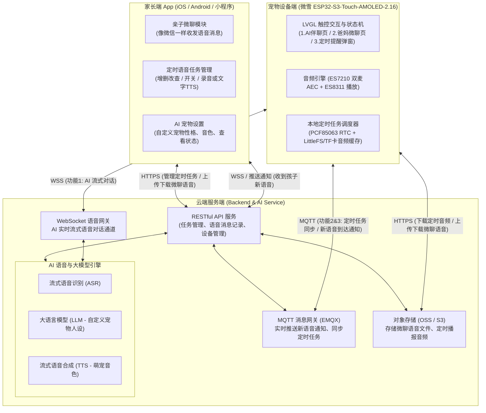
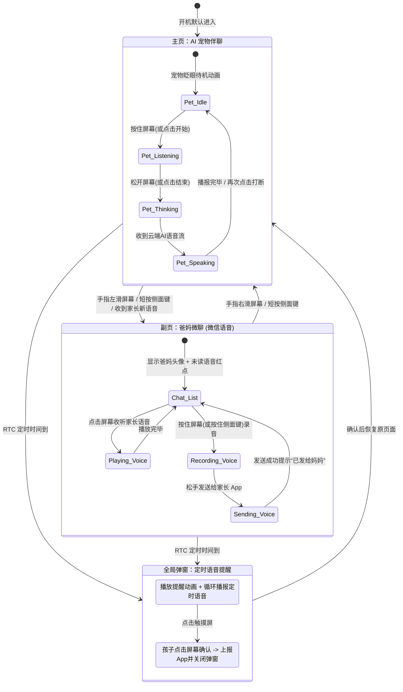
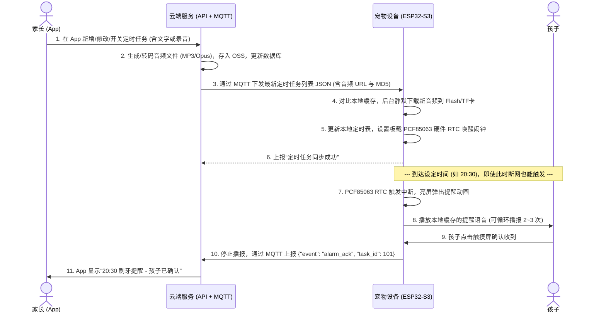

# 「小铭同学」—— 基于 ESP32-S3 的智能语音宠物（AI Chat Pet）产品与技术方案

## 1. 产品核心定位与三大功能可行性结论

本产品基于 **微雪（Waveshare）`ESP32-S3-Touch-AMOLED-2.16`** 高清触控语音开发板打造，聚焦于儿童日常陪伴与亲子沟通，包含以下 **三大核心功能**：

1. **功能一：与 AI 宠物对话聊天**
   * 小孩点击或按住屏幕与宠物说话，松手（或点击结束）后发送语音，AI 宠物结合专属性格人设与萌宠音色进行问答互动。
2. **功能二：定时语音播报（App 端可管理定时任务）**
   * 家长在手机 App 内随时增删改查、启用/禁用定时语音任务（支持输入文字转语音或家长直接录音），设备端准时响起播报并支持孩子点击屏幕确认。
3. **功能三：亲子双向微聊（类似微信语音功能）**
   * 家长在 App 里按住发送语音给宠物设备，设备可立即播报或提示孩子点击收听；孩子也可在设备上按住屏幕（或侧面物理按键）录音发送给家长 App，实现双向微信式语音沟通。

**可行性结论：100% 可行，且技术链路高度统一。**
上述三大功能在硬件底层完全共用同一套 **“触控/按键触发 -> 麦克风录音编码 -> 网络传输 -> 喇叭解码播报 + 屏幕动画反馈”** 机制，开发复用度极高，稳定性强，非常适合快速研发落地。

---

## 2. 硬件底座选型：微雪 ESP32-S3-Touch-AMOLED-2.16

直接选用 **`ESP32-S3-Touch-AMOLED-2.16`（推荐带外壳与喇叭电池的 Box 版）**，其板载资源与三大功能的对应关系如下：

| 硬件模块 | 板载芯片与规格 | 对应支撑的产品功能 |
| :--- | :--- | :--- |
| **主控与内存** | **ESP32-S3R8** (双核 240MHz)<br>**16MB Flash + 8MB PSRAM** + **TF卡槽** | 运行 LVGL 界面、GIF 宠物表情动画、Opus 音频编解码；16MB Flash 与 TF 卡用于存储**定时提醒音频**和**最近收发的微信语音消息**。 |
| **显示屏** | **2.16 寸高清方形 AMOLED 屏**<br>分辨率 480×480 (16.7M色)，QSPI 驱动 **CO5300** | 主页显示 AI 宠物高清灵动表情；副页显示“爸妈微聊”语音气泡；到点弹出定时闹钟提醒画面。 |
| **电容触摸屏** | **CST9220 电容触控芯片** (I2C)<br>高清钢化玻璃盖板 | 核心交互入口：支持**长按说话/松手发送**、**点击开始/点击结束**、**左右滑动切换“AI聊天”与“爸妈微聊”**。 |
| **侧面物理按键** | **3 个实体按键**：<br>1. 自定义功能键 (`GPIO18`) / `BOOT` 键 (`GPIO0`)<br>2. `PWR` 电源键 (`AXP2101`) | 极佳的快捷操作：可设置**按住屏幕=跟 AI 聊天**，**按住侧面自定义实体键=给爸妈发微信语音**（或短按切换页面），小孩盲操绝不混淆。 |
| **音频录放系统** | **ES7210 (双麦阵列 + 硬件回声消除 AEC)** + **ES8311 (音频解码 + 喇叭)** | 高清采集小孩说话语音（自带硬件 AEC 支持随时语音打断、AI 问答和发微信语音给家长）；清晰洪亮地播报 AI 回复、定时提醒和家长发来的语音。 |
| **独立硬件时钟** | **PCF85063 硬件 RTC 芯片** (I2C) | 支撑**功能二（定时语音播报）**：即使设备休眠或临时断网，硬件 RTC 依然精准走时并唤醒设备准点播报提醒。 |
| **电源与传感器** | **AXP2101 电源管理** + **QMI8658 六轴陀螺仪** | 精准监测电池电量百分比（App 端可查看设备电量）；陀螺仪支持小孩摇晃宠物触发趣味表情反应。 |

---

## 3. 系统总体架构设计

系统由 **宠物设备端（ESP32-S3）**、**云端业务与 AI 服务端**、**家长手机 App（或小程序）** 三端组成：



---

## 4. 设备端屏幕交互设计（如何让孩子轻松区分 3 个功能）

为了避免小孩混淆“跟 AI 宠物说话”和“给爸妈发微信语音”，利用 `2.16` 寸 `480×480` 电容触摸屏和侧面按键，设计**极简双页面 + 全局弹窗**：



> [!TIP]
> **快捷盲操技巧**：除了在屏幕上左右滑动切换页面，还可以把机身侧面的 **`BOOT` 物理按键（GPIO0）** 直接定义为 **“微聊专属对讲键”**——无论当前在哪个画面：
> * **手指按住触摸屏说话** = 跟 **AI 宠物** 聊天；
> * **手指按住侧面实体键说话** = 给 **爸爸妈妈** 发微信语音！
> 小孩一教就会，体验极其顺畅。

---

## 5. 三大核心功能详细设计

### 5.1 功能一：和 AI 对话、聊天

#### 交互与技术链路：
1. **触发录音**：小孩在宠物主页按住触摸屏（或点击屏幕开始），屏幕切换为“宠物竖起耳朵倾听”动图，麦克风（ES7210）以 16kHz 采样率录音并实时编码为 **Opus 音频帧**，通过 WebSocket 流式上传至云端。
2. **结束发送**：小孩松开手（或再次点击屏幕），ESP32 发送 `EOF` 结束标志，屏幕切换为“宠物歪头思考”动图。
3. **AI 思考与自定义**：
   * **ASR（语音转文字）**：识别小孩说的话。
   * **LLM（大模型回复）**：根据自定义的宠物人设 Prompt（如“你是5岁的小狗麦麦，性格活泼，回答简短易懂，每次不超过50字”）生成回答。
   * **TTS（文字转语音）**：将回答合成为可爱的卡通萌宠音色，边合成边通过 WebSocket 将音频流推回 ESP32。
4. **播报与嘴型同步**：ESP32 收到音频流后，屏幕切换为“宠物张嘴开心说话”动图，同时通过 ES8311 驱动喇叭播放声音。

---

### 5.2 功能二：定时语音播报（App 内管理定时语音任务）

#### 家长在 App 内的操作能力：
* **新建/编辑定时任务**：
  * **设定时间与重复周期**：如 `07:30`（周一至周五）、`20:30`（每天）、或单次定时。
  * **设定播报音源（二选一）**：
    1. **文字转语音（TTS）**：家长输入文字“宝贝，该去刷牙睡觉啦！”，云端自动用宠物卡通声音（或克隆的家长声音）生成音频。
    2. **家长亲自录音**：家长直接在 App 里录一段自己的声音作为闹钟铃声。
  * **任务开关与删除**：随时在 App 列表里开启/关闭某个定时任务，或删除任务。

#### 端云同步与准点播报流程：



---

### 5.3 功能三：亲子双向微信语音（App 与设备互发语音）

完全参照 **微信语音聊天** 的体验设计，支持语音消息持久化和历史回放。

#### 场景 A：家长在 App 发语音给设备（Parent -> Device）
1. **家长发送**：家长打开 App 的“微聊”聊天窗口，按住“按住说话”录音，松手发送（也可附带选择：**“设备收到后直接外放播报”** 还是 **“仅响提示音，等孩子点击再播”**）。
2. **云端转发**：App 将语音上传至云端 OSS，云端通过 **MQTT** 向设备推送一条新消息通知：
   ```json
   {
     "type": "new_voice_msg",
     "msg_id": "msg_98765",
     "sender": "妈妈",
     "audio_url": "https://oss.example.com/voice/msg_98765.mp3",
     "duration": 6,
     "auto_play": false
   }
   ```
3. **设备端接收与收听**：
   * 设备收到通知后，先把语音文件下载缓存到本地 TF 卡/Flash。
   * **若 `auto_play: true`（直接播报模式）**：宠物立刻亮屏说“妈妈发来消息啦”，紧接着直接播放家长的语音。
   * **若 `auto_play: false`（微信点击收听模式）**：宠物发出“叮咚~”提示音，屏幕弹出妈妈头像和未读红点气泡。孩子走过去**点一下触摸屏**，开始播放妈妈的语音；播完后通过 MQTT 回传 `已读（read）` 状态，家长 App 上的语音小红点消失。

#### 场景 B：孩子在设备上发语音给家长 App（Device -> Parent）
1. **孩子录音**：孩子滑到“爸妈微聊”界面按住触摸屏（或者在任意界面直接**按住机身侧面的物理按键**），对着宠物说：“妈妈，我做完作业啦，你什么时候回来呀？”
2. **松手发送**：
   * 孩子松开手，ESP32 将录好的音频（Opus/MP3/WAV）通过 HTTPS POST（或 WebSocket）上传到云端服务器。
   * 宠物屏幕显示发送成功动画，并提示“已经发给妈妈啦！”。
3. **家长端接收**：
   * 云端将该语音存入聊天记录表，并通过 App 消息推送（Push）通知家长手机。
   * 家长打开 App 就像聊微信一样，看到孩子发来的语音气泡（还可以顺便调用 ASR 在气泡下方自动附上语音转文字），点击即可收听。

---

## 6. 核心接口与数据结构草案（供后端与 App 开发参考）

### 6.1 定时语音任务数据结构 (`voice_schedules`)
```json
{
  "task_id": "sched_101",
  "device_id": "esp32_pet_001",
  "title": "晚上刷牙提醒",
  "cron_expr": "30 20 * * 1,2,3,4,5,6,7",
  "time_str": "20:30",
  "repeat_days": [1, 2, 3, 4, 5, 6, 7],
  "enabled": true,
  "source_type": "tts",          // "tts" (文字转宠物语音) 或 "record" (家长原声录音)
  "text_content": "宝贝，八点半啦，快去刷牙洗脸准备睡觉吧！",
  "audio_url": "https://cdn.example.com/schedules/sched_101.mp3",
  "audio_md5": "e10adc3949ba59abbe56e057f20f883e",
  "repeat_play_count": 2         // 到点响起时连续播放几次
}
```

### 6.2 亲子微聊语音消息数据结构 (`chat_voice_messages`)
```json
{
  "msg_id": "msg_20261116001",
  "device_id": "esp32_pet_001",
  "direction": "parent_to_device", // "parent_to_device" 或 "device_to_parent"
  "sender_name": "妈妈",
  "audio_url": "https://cdn.example.com/chat/msg_20261116001.mp3",
  "duration_sec": 5,
  "asr_text": "宝贝，妈妈下班在路上了，想吃什么水果？", // 可选：自动转文字方便家长开会时看
  "auto_play": false,
  "status": "unread",              // "unread" (未听) / "played" (已听)
  "created_at": "2026-11-16T18:00:00Z"
}
```

---

## 7. 推荐研发实施步骤（分三步走）

| 阶段 | 开发重点 | 详细任务 | 周期预估 |
| :--- | :--- | :--- | :--- |
| **第一步：跑通硬件与功能 1（AI 聊天）** | 设备端触控录放音 + AI 对话闭环 | 1. 在微雪 `ESP32-S3-Touch-AMOLED-2.16` 上跑通 `CO5300` (480×480) 屏幕、`CST9220` 触摸、侧面按键及 `ES7210/ES8311` 音频驱动（官方已提供 `waveshare/esp32_s3_touch_amoled_2_16` BSP 组件并原生兼容 `xiaozhi-esp32`）<br>2. 实现按住/点击屏幕录音 -> WebSocket 上传 -> 播放 AI 宠物语音回复与 GIF 表情切换 | **1 ~ 2 周** |
| **第二步：实现功能 3（亲子双向微信语音）** | App 与设备互发语音消息 | 1. 搭建后端 API、OSS 存储与 MQTT 消息通道<br>2. 开发 App 端“微聊”聊天界面（按住录音发送、收听孩子语音列表）<br>3. 设备端实现接收 MQTT 语音通知、播放家长语音，以及按住侧面键/副页屏幕录音上传给家长 | **1.5 ~ 2 周** |
| **第三步：实现功能 2（App 定时语音播报）** | App 定时任务管理 + 本地 RTC 准点播报 | 1. 开发 App 端“定时提醒管理”页面（增删改查、开关、录音/文字转语音）<br>2. 设备端实现定时音频预下载（Flash/TF卡）与 **PCF85063 硬件 RTC** 定时触发<br>3. 实现提醒弹窗动画与孩子点击屏幕确认回传 | **1 ~ 1.5 周** |
